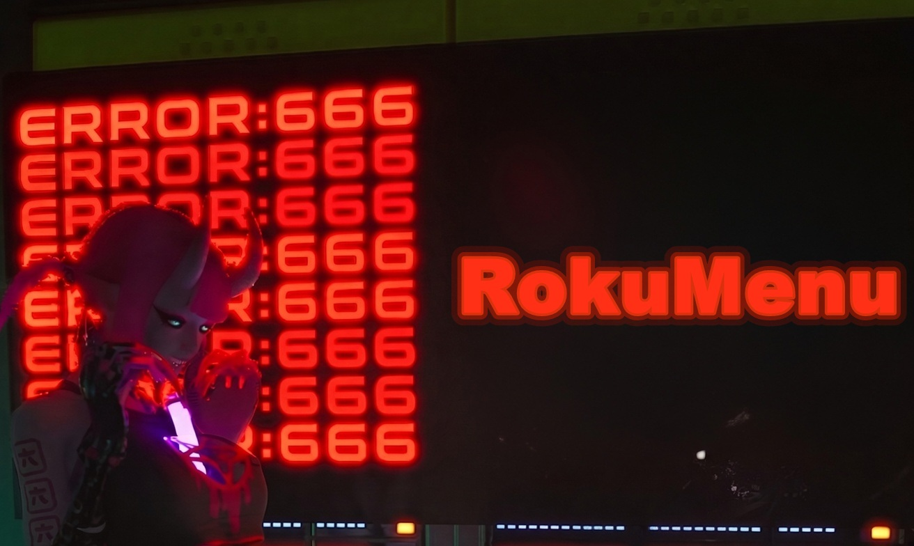

# RokuMenu

UE4SS in-game menu for **GON: God of Nothing**.

Tab opens it. Cheats, outfits, camera tools, saved mouse and volume. Does not replace game files.



## Download

Grab a version from **[Releases](https://github.com/mrdude2x/Roku-Menu/releases)**. Use the named zip on the release page, not GitHub's "Source code" zip.

| Version | Date | Download |
| --- | --- | --- |
| **v0.5.1** (latest, GON 1.3) | 2026-10-12 | [RokuMenu_v0.5.1.zip](https://github.com/mrdude2x/Roku-Menu/releases/download/v0.5.1/RokuMenu_v0.5.1.zip) |
| v0.5 | 2026-10-11 | [RokuMenu_v0.5.zip](https://github.com/mrdude2x/Roku-Menu/releases/download/v0.5/RokuMenu_v0.5.zip) |
| v0.4 | 2026-10-08 | [RokuMenu_v0.4.zip](https://github.com/mrdude2x/Roku-Menu/releases/download/v0.4/RokuMenu_v0.4.zip) |
| v0.3 | 2026-10-02 | [RokuMenu_v0.3.zip](https://github.com/mrdude2x/Roku-Menu/releases/download/v0.3/RokuMenu_v0.3.zip) |
| v0.2.1 | 2026-09-26 | [RokuMenu_v0.2.1.zip](https://github.com/mrdude2x/Roku-Menu/releases/download/v0.2.1/RokuMenu_v0.2.1.zip) |
| v0.2 | 2026-09-25 | [RokuMenu_v0.2.zip](https://github.com/mrdude2x/Roku-Menu/releases/download/v0.2/RokuMenu_v0.2.zip) |
| v0.1 | 2026-09-24 | [RokuMenu_v0.1.zip](https://github.com/mrdude2x/Roku-Menu/releases/download/v0.1/RokuMenu_v0.1.zip) |

## Needs

- GON: God of Nothing on Steam
- Windows 11 or 10. On Linux, add this to Steam launch options: `WINEDLLOVERRIDES="dwmapi=n,b" %command%`

The v0.5.1 zip already includes Experimental UE4SS `UE4SS_v3.0.1-1165-g12ec45a0`. The GitHub "latest" 3.0.1 build does not run on Unreal 5.7.

## Credit

UE4SS is by [UE4SS-RE](https://github.com/UE4SS-RE/RE-UE4SS). Copyright (c) 2022 Narknon. MIT license: [UE4SS-LICENSE.txt](UE4SS-LICENSE.txt). The bundled build and checksum are in [CREDITS.txt](CREDITS.txt).

## Install

See **[Install_Guide.pdf](Install_Guide.pdf)** in this repo or inside the zip.

1. Extract `RokuMenu_v0.5.1.zip` into `Roku3\Binaries\Win64`, next to `Roku3-Win64-Shipping.exe`.
2. `dwmapi.dll` and the `ue4ss` folder should sit beside that exe. Click Yes if Windows asks to replace files.
3. The menu folder must be exactly `ue4ss\Mods\RokuMenu`, with `enabled.txt` left inside it.
4. NumLock on for numpad keys. Tab opens the menu.

Already have UE4SS and other mods? Do not extract this over that folder. Copy `ue4ss\Mods\RokuMenu` and `ue4ss\Mods\shared\ModMenu` into the Mods folder you already have. Leave `shared\UEHelpers` in place.

## Win64 zip

```
dwmapi.dll
ue4ss/UE4SS.dll
ue4ss/LICENSE
ue4ss/Mods/RokuMenu/
ue4ss/Mods/shared/ModMenu/
ue4ss/Mods/shared/UEHelpers/
ReadMe.txt
Install_Guide.pdf
CREDITS.txt
UE4SS-LICENSE.txt
```

`config.json` is created in-game. It stays on that PC and is not in this repo. The UE4SS program files are in the release zip, not in the git history.

## Current version

v0.5.1 for GON 1.3. Full feature list is in `ReadMe.txt`.